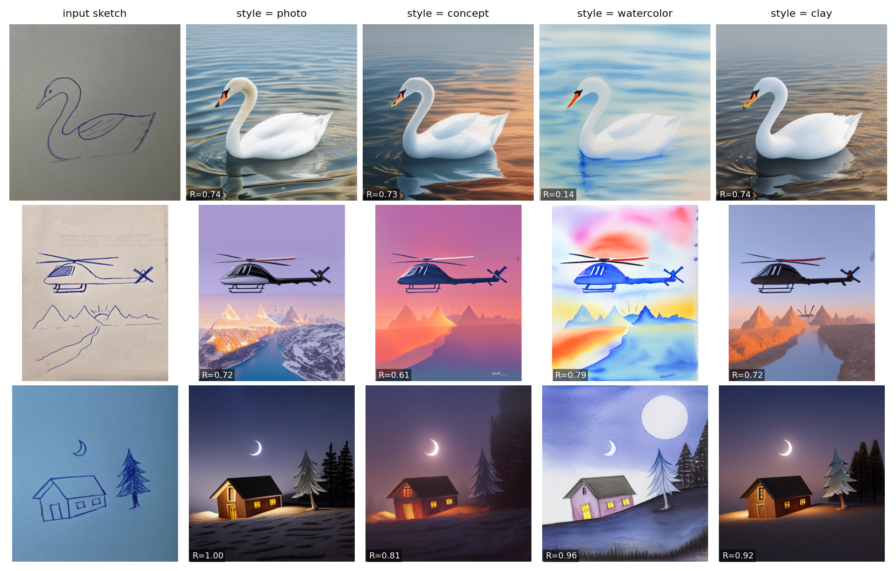
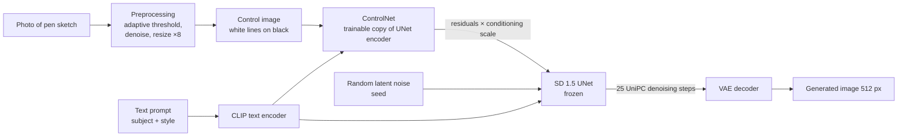
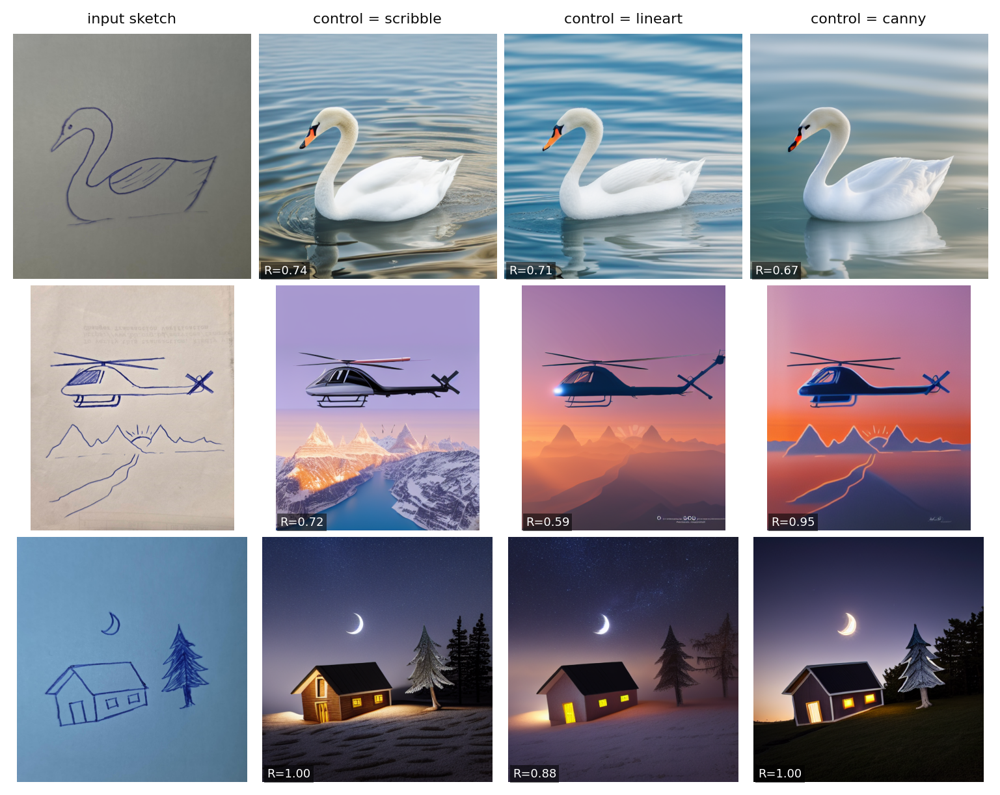
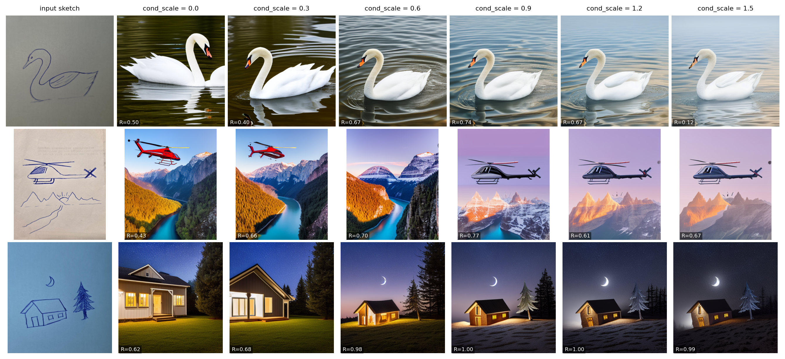
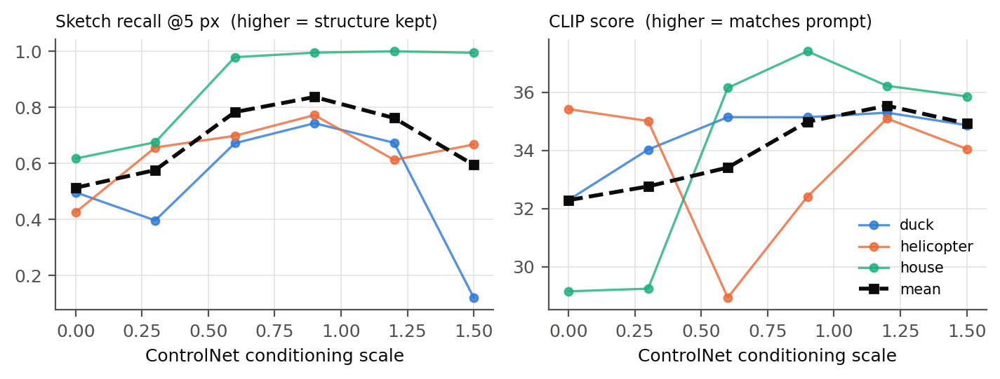
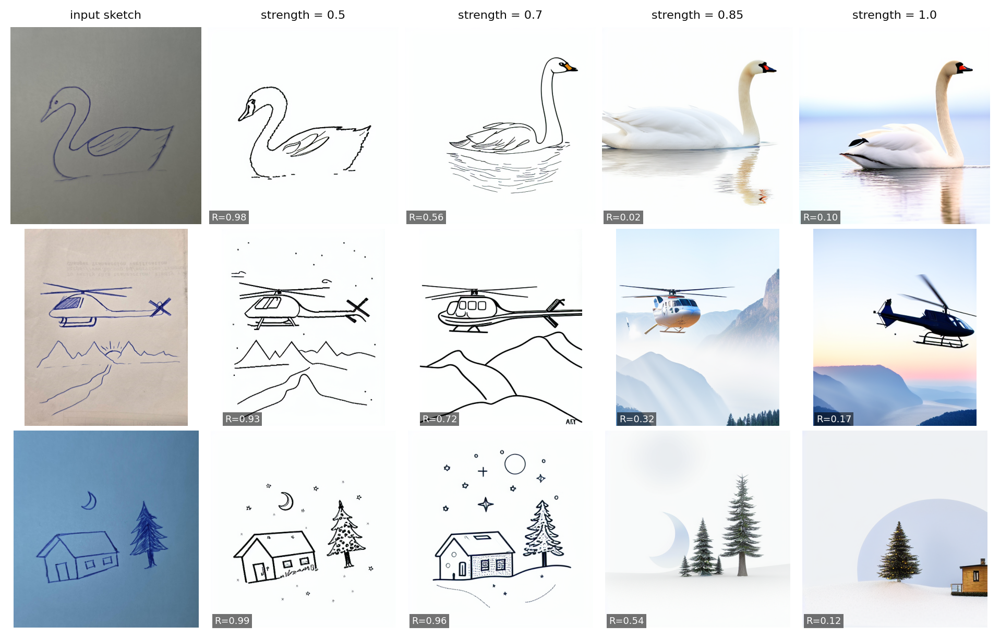
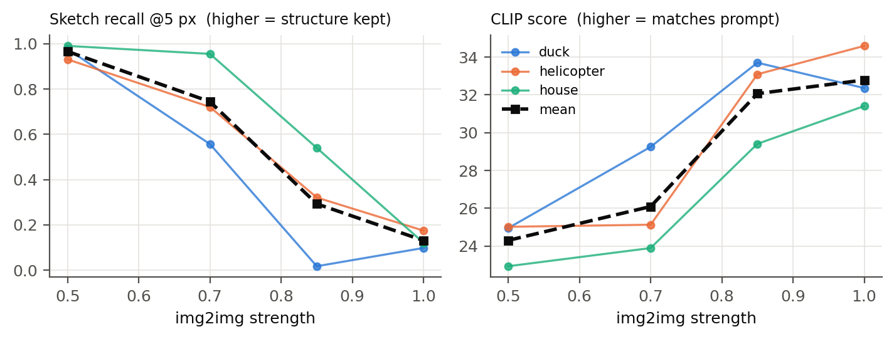
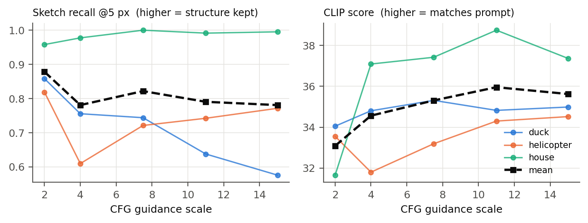
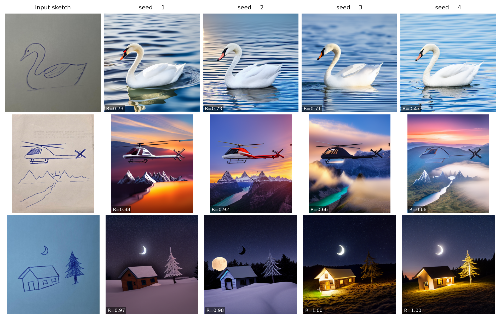

# Sketch2Image: Bringing Sketches to Life with Generative AI

In this project I turn my own hand-drawn pen sketches into realistic or stylised images with **Stable Diffusion 1.5 + ControlNet**. I also measure how well each result keeps the structure of the sketch.



---

## 1. How it works



**Stable Diffusion (latent diffusion).** A VAE compresses a 512×512 image into a 64×64×4 latent. A UNet learns to predict the noise in a noisy latent, using the text embedding from CLIP through cross-attention. Generation starts from pure noise and removes it step by step. I use the UniPC sampler with 25 steps. At the end the VAE decoder turns the latent back into pixels.

**How my sketch controls the image (ControlNet).** ControlNet is a trainable copy of the UNet encoder that gets the control image (my sketch) as an extra input. Its feature maps go through *zero-initialised* 1×1 convolutions and are **added to the skip connections and the middle block of the frozen SD UNet at every denoising step**. The original SD weights are not changed. The sketch only adds a spatial "where things are" signal. The **conditioning scale** multiplies these residuals:
- 0: plain text-to-image (sketch is ignored)
- 1: the strength used in training
- more than 1: the sketch is forced more strongly

**Classifier-free guidance (CFG).** At each step the UNet runs twice: with the prompt and without it (the "without" branch uses the negative prompt). The difference is multiplied by the *guidance scale*. A higher value follows the prompt more, but the colours become over-saturated.

**Baseline: img2img (SDEdit).** Here I do not use ControlNet. The sketch itself is noised (how much is set by `strength`) and then denoised with the prompt. The structure is kept only through the starting image, so there is a direct trade-off: low strength still looks like a pen drawing, high strength loses the layout. I compare it with ControlNet to show why a separate conditioning network is needed.

**Three ControlNet types that I compare:**

| Control | Model | Control image | Trained on |
|---|---|---|---|
| `scribble` | `control_v11p_sd15_scribble` | sketch lines, made thicker (dilated ×2) | synthetic rough scribbles |
| `lineart` | `control_v11p_sd15_lineart` | sketch lines, thin | line drawings extracted from images |
| `canny` | `control_v11p_sd15_canny` | Canny edges of the sketch photo | Canny edge maps |

---

## 2. Files

```
sketch2image/
├── sketch2img.py          preprocessing + Generator class + single-image command
├── metrics.py             sketch-preservation metric + CLIP score
├── run_experiments.py     runs all experiments in config.yaml -> outputs/results.csv
├── make_figures.py        comparison grids, curves, LaTeX tables
├── app.py                 Gradio web UI
├── config.yaml            models, sketches, prompts, default settings, experiments
├── Sketch2Image.ipynb     Colab notebook that runs everything
├── requirements.txt
├── sketches/              my input sketches
└── outputs/               control images, figures, tables, metrics
```

---

## 3. Installation

I ran everything on Google Colab with a free **T4 GPU** (16 GB). Kaggle also works (GPU T4, Internet on).

**Colab:** open `Sketch2Image.ipynb` (*Runtime → Change runtime type → T4 GPU*) and run all cells.

**Local** (NVIDIA GPU with ≥ 8 GB VRAM, Python ≥ 3.10):
```bash
git clone https://github.com/MarufDzine/sketch2image.git
cd sketch2image
pip install torch --index-url https://download.pytorch.org/whl/cu121   # if torch is not installed
pip install -r requirements.txt
```
The models (~9 GB) download automatically from the Hugging Face Hub on the first run.

---

## 4. Usage

```bash
# one image
python sketch2img.py --sketch sketches/house.jpeg \
    --prompt "a small house next to a pine tree at night, photorealistic" --control scribble --cond-scale 1.0 --out out.png

# all experiments (78 images, ~10-12 min on a T4), then figures and tables
python run_experiments.py
python make_figures.py

# only some experiments
python run_experiments.py --only styles cond_scale

# test the code without a GPU
python run_experiments.py --dry-run

# web UI
python app.py --share
```
Generated images are saved in `outputs/images/`. If Colab disconnects, I just re-run and it continues where it stopped.

---

## 5. Reproducibility: main settings

| Setting | Value |
|---|---|
| Base model | `stable-diffusion-v1-5/stable-diffusion-v1-5` (fp16) |
| ControlNets | `lllyasviel/control_v11p_sd15_{scribble, lineart, canny}` |
| Scheduler | UniPC multistep, 25 steps |
| Resolution | longest side 512 px, both sides multiples of 8 |
| Guidance scale | 7.5 |
| ControlNet conditioning scale | 1.0 |
| img2img strength | 0.8 |
| Seed | 42 (PyTorch generator on the GPU) |
| Negative prompt | `lowres, blurry, bad anatomy, deformed, …` (see `sketch2img.py`) |
| Prompt | `"<subject>, <style text>"`, both in `config.yaml` |
| Safety checker | disabled (all inputs are my own simple sketches) |

All settings are in `config.yaml`. Each experiment changes **one** setting and keeps the others at the defaults above.

| Experiment | Setting changed | Values |
|---|---|---|
| `styles` | style text in the prompt | photo, concept art, watercolor, clay |
| `cond_scale` | ControlNet conditioning scale | 0, 0.3, 0.6, 0.9, 1.2, 1.5 |
| `guidance` | CFG scale | 2, 4, 7.5, 11, 15 |
| `control` | ControlNet type | scribble, lineart, canny |
| `img2img` | img2img strength (baseline, no ControlNet) | 0.5, 0.7, 0.85, 1.0 |
| `seeds` | random seed | 1, 2, 3, 4 |

Note: pixel values can be a little different on other GPU types or library versions, even with the same seed.

---

## 6. Evaluation metrics

- **Sketch recall @5 px (higher is better).** I skeletonise the sketch lines to 1-px centre lines and detect edges in the generated image with Canny (thresholds set from the median intensity). Recall is the fraction of sketch pixels that have a generated edge within 5 px (~1 % of the image size).
- **Chamfer distance (px, lower is better).** Mean distance from the sketch centre lines to the nearest generated edge, computed with a distance transform.
- Both metrics only go in one direction on purpose. A good result *adds* texture and details, so extra edges in the output are not punished.
- **CLIP score (higher is better).** 100 × cosine similarity between the CLIP ViT-B/16 image and prompt embeddings ([Hessel et al., 2021](https://arxiv.org/abs/2104.08718)). It shows how well the image matches the text.
- Sanity checks on a test sketch: the sketch scored against itself gives recall = 1.0, the sketch shifted by 20 px drops to 0.26–0.60, and an image with no edges gives 0.

---

## 7. Results

Input sketches: `duck`, `helicopter` and `house` in `sketches/`. The full discussion is in my report.









Mean and standard deviation of all metrics: `outputs/tables/summary.csv` (LaTeX versions in `outputs/tables/*.tex`).

---

## 8. References

**Papers**
1. Rombach, R. et al. *High-Resolution Image Synthesis with Latent Diffusion Models.* CVPR 2022. [arXiv:2112.10752](https://arxiv.org/abs/2112.10752)
2. Zhang, L., Rao, A., Agrawala, M. *Adding Conditional Control to Text-to-Image Diffusion Models* (ControlNet). ICCV 2023. [arXiv:2302.05543](https://arxiv.org/abs/2302.05543)
3. Ho, J., Salimans, T. *Classifier-Free Diffusion Guidance.* 2022. [arXiv:2207.12598](https://arxiv.org/abs/2207.12598)
4. Meng, C. et al. *SDEdit: Guided Image Synthesis and Editing with Stochastic Differential Equations.* ICLR 2022. [arXiv:2108.01073](https://arxiv.org/abs/2108.01073)
5. Zhao, W. et al. *UniPC: A Unified Predictor-Corrector Framework for Fast Sampling of Diffusion Models.* NeurIPS 2023. [arXiv:2302.04867](https://arxiv.org/abs/2302.04867)
6. Radford, A. et al. *Learning Transferable Visual Models From Natural Language Supervision* (CLIP). ICML 2021. [arXiv:2103.00020](https://arxiv.org/abs/2103.00020)
7. Hessel, J. et al. *CLIPScore: A Reference-free Evaluation Metric for Image Captioning.* EMNLP 2021. [arXiv:2104.08718](https://arxiv.org/abs/2104.08718)
8. Canny, J. *A Computational Approach to Edge Detection.* IEEE TPAMI, 1986.

**Models (Hugging Face)**
- Stable Diffusion v1.5: [stable-diffusion-v1-5/stable-diffusion-v1-5](https://huggingface.co/stable-diffusion-v1-5/stable-diffusion-v1-5) (CreativeML OpenRAIL-M licence)
- ControlNet v1.1 by L. Zhang: [scribble](https://huggingface.co/lllyasviel/control_v11p_sd15_scribble), [lineart](https://huggingface.co/lllyasviel/control_v11p_sd15_lineart), [canny](https://huggingface.co/lllyasviel/control_v11p_sd15_canny)
- CLIP ViT-B/16: [openai/clip-vit-base-patch16](https://huggingface.co/openai/clip-vit-base-patch16)

**Libraries**
- [🤗 Diffusers](https://github.com/huggingface/diffusers), [🤗 Transformers](https://github.com/huggingface/transformers), [PyTorch](https://pytorch.org), [OpenCV](https://opencv.org), [scikit-image](https://scikit-image.org), [Gradio](https://gradio.app), pandas, matplotlib, PyYAML

**Sketches.** All sketches in `sketches/` are my own drawings (pen on paper, photographed with my phone).

**AI assistance.** I used an AI assistant (Claude, Anthropic) to help with the code structure, parts of the implementation and the documentation. I chose the approach and the sketches, ran and tested all code, ran all experiments, checked the results, and I can explain every part of the pipeline.
